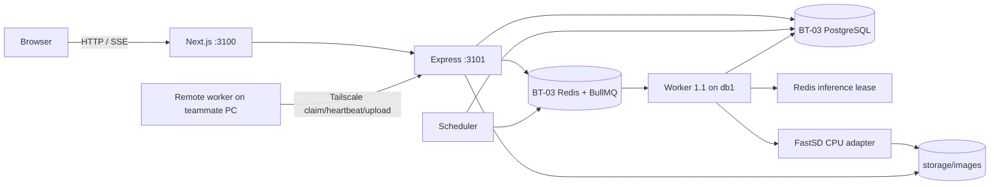

# Architecture

PostgreSQL, Redis and image storage remain on `db1`. The API also listens on the Tailscale IP at port 3102 when the remote Compose override is applied. Remote workers claim jobs and upload PNG files through authenticated API routes; they do not connect to PostgreSQL or Redis. Local and remote claims use conditional database updates, so only one worker receives a job. The Redis lease limits simultaneous inference only on `db1`; remote machines can work in parallel. Inference is one-shot per job to bound RAM usage.

Images are stored by safe relative names and served only after UUID lookup. Both local worker and API write a temporary PNG then hard-link it to the unique final name; PostgreSQL metadata is inserted afterward. A crash between file creation and database commit can leave an orphan PNG, which should be reconciled in a maintenance tool before production use.
